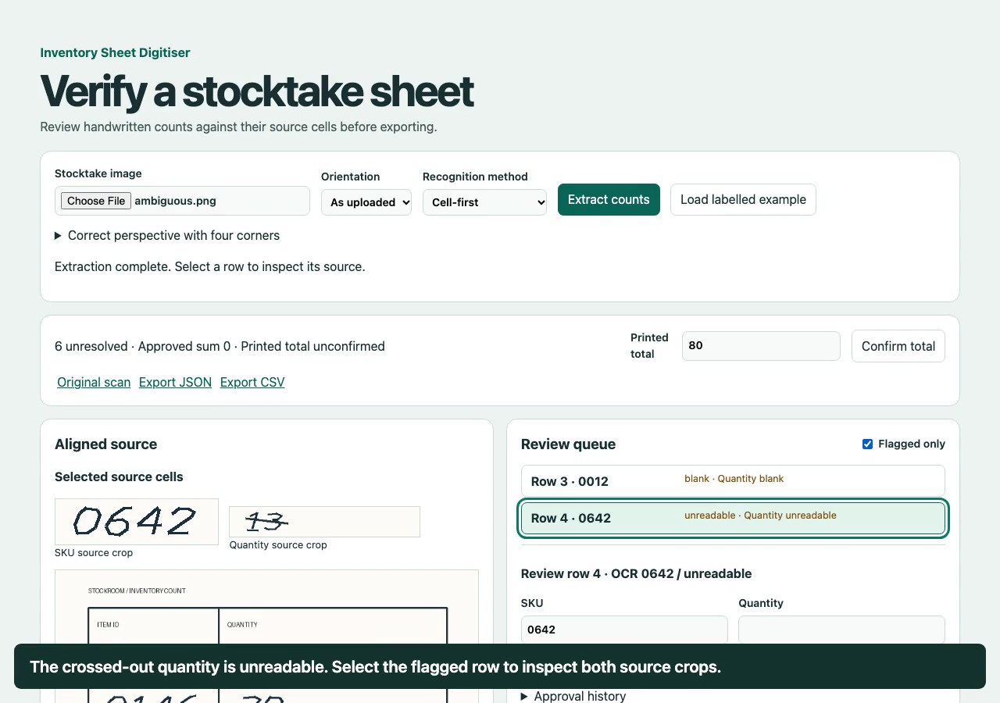

# Handwritten Inventory Sheet Digitiser

Turn ruled stocktake sheets into source-linked inventory records. Upload a photo, inspect each recognised SKU and count beside its source crop, then correct and approve the rows you want to export.

## Watch the workflow

[66-second captioned walkthrough](https://raw.githubusercontent.com/Khushx11/handwritten-inventory-digitiser/main/docs/demo/walkthrough.mp4)

[](https://raw.githubusercontent.com/Khushx11/handwritten-inventory-digitiser/main/docs/demo/walkthrough.mp4)

## Run locally

Use Python 3.11–3.13.

```sh
python -m venv .venv
source .venv/bin/activate
python -m pip install .
inventory-digitiser
```

Open <http://127.0.0.1:8010> and choose **Load labelled example**, or upload a PNG, JPEG or WebP up to 10 MB. Accepted sheets have two ruled columns, a header and a final total row. The total cell may be blank. Use the orientation control or select four page corners to correct photos with perspective distortion. The workspace stores original and aligned images and review history locally in `runtime/`.

Use Tab and Enter to select a row. The source view highlights both cells and shows the original crops. Approved rows export to JSON or CSV. The JSON lists unresolved rows. CSV preserves the SKU strings on disk. When importing into a spreadsheet, select text for the SKU column so the spreadsheet preserves leading zeros.

## What the benchmark found

- **52.8% exact row accuracy** on 72 clean rows rendered from six held-out UCI writers across two layouts excluded from development. Cell-first and page-first tied on accuracy.
- **12 of 72 clean rows** passed the simulated review threshold at 0.80, with no errors among those 12. On skewed sheets, two incorrect quantities passed at that same threshold.
- Synthetic sheets composed entirely of procedural ink are measured separately. The app requires human approval before exporting any record.

See the [evaluation protocol and measured results](docs/evaluation.md) and [data provenance and attribution](docs/data.md).

```sh
python -m inventory.evaluate --output docs/metrics.json
curl --fail --location 'https://archive.ics.uci.edu/static/public/160/uji+pen+characters.zip' -o /tmp/uji-pen.zip
python -m inventory.writer_benchmark /tmp/uji-pen.zip --output docs/writer-metrics.json
python -m unittest discover -s tests -v
```

## Additional handwriting model

The optional MNIST and PenDigits model scored **97.46%** and **93.40%** on their respective official test partitions. It reached **86.1% exact row accuracy** on the same clean writer-held-out stocktake composites. The benchmark still found wrong quantities above the simulated acceptance threshold. [Results and training instructions](docs/additional-handwriting.md)

## Difficult scans

Try **Blurred photo**, **Faint handwriting** or **Crowded digits** from the example selector. The app shows scan-quality warnings and flags faint recovered readings for review. An optional degradation-trained model improved exact rows in the paired blur tests. [Stress results and reproduction](docs/difficult-scans.md)

## Design

- **Alignment and extraction** use bounded image decoding, manual corner correction, deskew, ruled-grid detection and offline digit classification.
- **Review** flags uncertain reads, unknown SKUs, blanks, unreadable marks and duplicate candidates. Suggestions never replace the raw OCR. Explicit edits and reopening events are recorded with their previous values.
- **Reconciliation** compares an OCR-read printed total with the sum of approved quantities once all rows are resolved. Reviewers can confirm a printed total separately and preserve the original OCR reading. An uncertain or missing total stays unknown until confirmed. The total never fills a missing quantity.
- **Storage** uses SQLite for approval history and the local filesystem for scans. The HTTP server binds to loopback. Use the demo locally with non-sensitive images.

The current model supports digits and a documented two-column format. Real-world sheet accuracy is unverified. The benchmark uses stylus strokes composited onto generated tables, so its metrics should guide review design rather than stock-control decisions.
