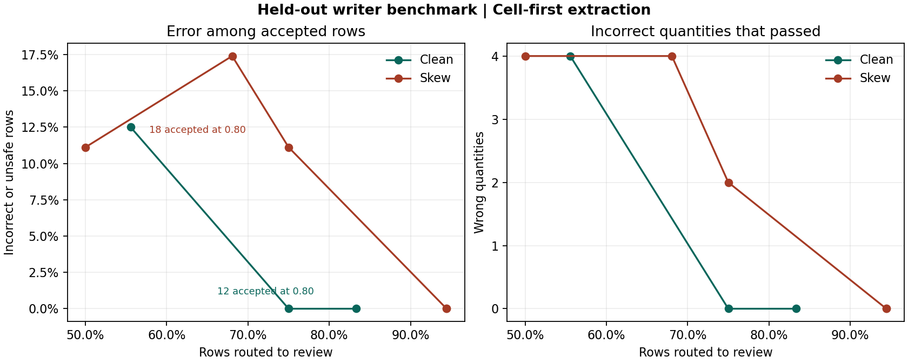

# Evaluation protocol

The cell-first pipeline crops each grid cell before segmentation. The page-first baseline segments the de-ruled page globally, then assigns glyphs to cells by centroid. They share the same digit classifier, deskew algorithm, table geometry and review policy. A layout discovery failure contributes failed rows to the denominator.

Both benchmarks use the same fixed threshold grid and measure the percentage of cells in rows sent to review. The app requires explicit human approval of every exported row. Benchmark acceptance is a simulation used to quantify potential workload and risk.

## Measured results

On 72 clean rows composited from six held-out UCI writers across two held-out layouts, both strategies reached 52.8% exact row accuracy, 58.3% exact SKU accuracy, 83.3% exact quantity accuracy and 16.3% character error rate. Row alignment was 100% on these generated sheets. Warm mean processing time was about 20 ms per sheet for cell-first and 22 ms for page-first on the local Mac. The accuracy tie gives no evidence that cell-first improves recognition on this benchmark.

At the fixed 0.80 threshold, both methods marked 60 of 72 clean rows for review. All 12 remaining rows were correct. Across the skew stress condition, two incorrect quantities passed the same threshold among 18 accepted rows. The model's neighbour vote is uncalibrated. A low review rate alone is insufficient to justify automatic export.

On the separate procedural clean benchmark (24 held-out rows per method), both methods reached 50.0% exact row accuracy and 83.3% exact quantity accuracy. Consult the raw outputs for blur, shadows, skew, crossed-out ink and risk at every threshold.

- [Writer-held-out row measurements](writer-metrics.json)
- [Procedural row measurements](metrics.json)

The plotted points span the fixed threshold grid. The default 0.80 points are labelled with the accepted-row count. Rows are routed as a unit, so the fraction of cells in reviewed rows equals the row review rate.

A row is aligned when both detected cell centres fall in the expected columns and within a quarter of a row height of its expected centre. Character error uses edit distance divided by reference characters. Quantity exact match distinguishes a blank from an unreadable value. The risk calculation treats a crossed-out quantity as requiring review even when digits happen to match. Warm latency excludes model initialisation and HTTP transport.
